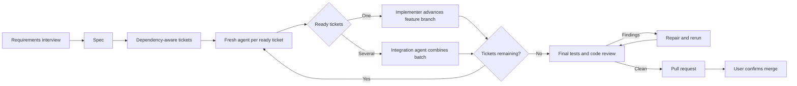

# Ship Feature

**A coordinated workflow for shipping a feature from requirements to a reviewed pull request.**

Ship Feature keeps the main agent responsible for the ticket graph and gives each implementer exactly one ticket. Independent tickets run in parallel in separate Git worktrees. A single-ticket batch advances the feature branch directly; a parallel batch is combined by a fresh integration agent. Final tests and code review run against the same feature commit before a PR is opened.

## Workflow



The coordinator reports each integrated batch in the main conversation. Dependent tickets start only after their prerequisites are present on the shared feature branch. GitHub issues close after that branch is pushed, and the final review and test reports must refer to the same commit.

## Requirements

- A Git repository hosted on GitHub, with `git` and an authenticated [GitHub CLI](https://cli.github.com/) (`gh`).
- An agent host that can launch fresh subagents and use Git worktrees. Parallel work requires concurrent subagents.
- Node.js 22.20 or later to run the [Skills CLI](https://github.com/vercel-labs/skills) installer. Node.js is needed for installation, not for the skill's workflow.

The workflow uses the repository's default branch as its PR base, creates a `feat/<slug>` branch, and writes spec, ticket, and report artifacts under `.scratch/<slug>/`. It also creates GitHub issues and, after the final checks pass, a pull request. It waits for explicit user confirmation before merging into the default branch.

## Install

Run the installer in your system terminal:

```sh
npx skills add Techkilladis/ship-feature
```

The interactive installer lets you choose agents and whether the skill is available in the current project or globally across projects. Global scope applies to the agents you select; choose every agent if you want it available everywhere.

| Target | Global install command | Invoke |
| --- | --- | --- |
| Antigravity | `npx skills add Techkilladis/ship-feature -g -a antigravity` | `/ship-feature` |
| Codex | `npx skills add Techkilladis/ship-feature -g -a codex` | `$ship-feature` |
| Claude Code | `npx skills add Techkilladis/ship-feature -g -a claude-code` | `/ship-feature` |

Antigravity reads global skills from `~/.gemini/config/skills/`. If it was already open during installation, restart it or reload skills. The installer command is **`npx skills`** (plural); `npx skill` is a different package. See the [supported-agent paths](https://github.com/vercel-labs/skills/blob/main/docs/agents.md) and [Antigravity's skill documentation](https://antigravity.google/docs/skills).

To check installed global skills:

```sh
npx skills list -g
```

## Operating model

| Owner | Responsibility | Handoff |
| --- | --- | --- |
| Main agent | Interviews the user, tracks ticket dependencies, dispatches fresh agents, and reports progress | Ready ticket IDs and the current feature commit |
| Ticket implementer | Completes one ticket in its own worktree and branch | Ticket branch and commit |
| Integration agent | Combines a parallel batch and resolves real conflicts | Pushed feature commit and closed issues |
| Test and review agents | Check the complete feature independently | Reports tied to one commit |
| Repair agent | Addresses final findings | New feature commit for both checks to rerun |

For one ready ticket, its implementer advances the feature branch and closes that issue; there is no extra integration agent. For several ready tickets, implementers push separate branches and the integration agent combines them once. A failed batch holds its dependents until integration succeeds.

## Control points and recovery

- **Design:** The user confirms the requirements interview before the spec is written.
- **Integration:** A ticket unblocks its dependents only when its commit is on the remote feature branch. A closed issue alone is not enough.
- **Verification:** Final tests and the two-axis review must cover the same feature commit. Any repair triggers both checks again.
- **Merge:** The PR remains unmerged until the user confirms it. Existing worktree changes are preserved.
- **Resume:** The coordinator records issue IDs, blockers, branch commits, and reports in `.scratch/<slug>/run-state.md`, then reconciles that record with GitHub before continuing an interrupted run.

## Reference material

The workflow is defined in [SKILL.md](SKILL.md). Phase-specific guidance lives in [references/](references/), including ticket slicing, test-driven implementation, code review, and PR preparation. Bundled reference material adapted from [Matt Pocock's skills](https://github.com/mattpocock/skills) is distributed with its [MIT license notice](references/LICENSE).
